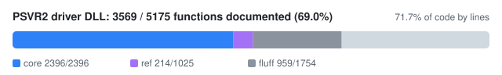

# PSVR2 for Linux

[](https://github.com/unterschall/psvr2-linux-adapter/actions/workflows/build.yml)

An open project to bring the Sony **PlayStation VR2** to Linux: a kernel module
that exposes the headset's sensors and cameras through standard Linux subsystems,
a small userspace library over those device nodes, and a **SteamVR driver** that
presents the headset as a native VR HMD. It targets the official Sony PSVR2 PC
adapter.

Contributions are very welcome — see [Contributing](#contributing).

> Not affiliated with or endorsed by Sony Interactive Entertainment.

## What it does

The `psvr2` kernel module binds the headset's vendor interfaces and exposes:

- **IMU** (accelerometer + gyroscope, ~2 kHz) via the **IIO** subsystem, with
  correct `*_scale` attributes (m/s² and rad/s).
- **Function button**, **proximity sensor** (worn/removed) and **IPD dial**
  (59–72 mm) via the **input** subsystem.
- **6DoF pose** from the headset's onboard tracker as a sample stream on the
  **`/dev/psvr2-pose`** character device (`read()` + `poll()`; ABI in
  `kernel/psvr2_uapi.h`).
- **Eye/gaze tracking** (per-eye + combined gaze point/direction, pupil
  diameter, blink) on the **`/dev/psvr2-gaze`** character device.
- **Tracking cameras** as a **V4L2** capture device (`/dev/videoN`).
- **Panel brightness** via **sysfs**, and **debugfs** raw-frame dumps for
  protocol work.

On top of that:

- **`libpsvr2`** — a small C library over the device nodes (6DoF pose and gaze
  streams, scaled IMU, camera-node path, brightness) for building VR-runtime
  integrations.
- **SteamVR driver** (`steamvr/driver_psvr2`) — presents the PSVR2 as a native
  SteamVR HMD with direct-mode display (via DRM leasing), 6DoF head tracking,
  Sony's lens model, OpenXR eye gaze and headset rumble (jailbreak), and drives
  the **Sense controllers** over Bluetooth: all inputs, PCM haptics and
  adaptive triggers, with 3DoF orientation and an arm-model position (6DoF
  controller tracking is not done yet). A PSVR2 Toolkit-compatible IPC server
  serves Toolkit-aware apps. See [getting-started.md part C](docs/getting-started.md#part-c-steamvr-driver).

Audio is handled by the in-tree `snd-usb-audio` driver and left untouched. The
display is a standard DisplayPort sink driven by the GPU's DRM stack (see
[getting-started.md part B](docs/getting-started.md#part-b-display-bring-up)).

See [development.md part C](docs/development.md#part-c-status-and-roadmap) for current status and planned work.

## Architecture

A thin kernel module integrates device data into standard Linux subsystems;
heavier parsing (cameras, tracking, eye tracking) and runtime integration live in
userspace. The module binds **only** the vendor interfaces it implements, so it
never contends with `snd-usb-audio` or `usbhid`.

| Path                | Owner                                          |
|---------------------|------------------------------------------------|
| Display (DP 1.4)    | GPU DRM driver (+ DSC/FEC quirk in `patches/`)  |
| Audio               | `snd-usb-audio` (unchanged)                     |
| IMU / buttons       | **this module** → IIO + input                   |
| 6DoF pose           | **this module** → `/dev/psvr2-pose`             |
| Cameras             | **this module** → V4L2 `/dev/videoN`            |
| Eye / gaze tracking | **this module** → `/dev/psvr2-gaze`             |
| VR runtime          | **`libpsvr2`** → SteamVR driver / OpenXR shims  |

See [hardware-protocol.md part A](docs/hardware-protocol.md#part-a-hardware-and-usb-topology) and [hardware-protocol.md part B](docs/hardware-protocol.md#part-b-usb-protocol).

## Build & load

```bash
# Kernel module (needs linux-headers for your running kernel)
make -C kernel
sudo insmod kernel/psvr2.ko          # or install via DKMS, see below

# Userspace smoke tests
make -C userspace/tools
```

Connect the headset via the Sony PC adapter, then:

```bash
dmesg | grep psvr2                   # probe messages
lsusb -t                             # confirm audio still on snd-usb-audio
ls /sys/bus/iio/devices/             # an iio:deviceN named "psvr2_imu"
sudo evtest                          # pick "PlayStation VR2 Headset Controls"
userspace/tools/psvr2-imu-test       # live scaled IMU + control events
userspace/tools/psvr2-pose-test      # live 6DoF pose from /dev/psvr2-pose
userspace/tools/psvr2-gaze-test      # live eye-tracking from /dev/psvr2-gaze

v4l2-ctl --list-devices              # find the "PlayStation VR2 Cameras" node
v4l2-ctl -d /dev/videoN --stream-mmap --stream-count=30 --stream-to=frames.grey
# or view live: gst-launch-1.0 v4l2src device=/dev/videoN ! videoconvert ! autovideosink
```

High-rate buffered IMU capture works with `libiio` (`iio_readdev`) against the
`psvr2_imu` device.

### Install (persistent)

```bash
./install.sh            # module (DKMS), udev rules, input group, SteamVR driver,
                        # steamvr.vrsettings; asks for sudo where needed
git pull && ./install.sh --update   # later: redo only what changed
./install.sh --set headset_ins=false   # driver_psvr2 overrides in steamvr.vrsettings
# Arch: cd packaging && makepkg -si  # builds the psvr2-dkms package
```

`./uninstall.sh` reverses it (`--all` also removes libpsvr2 and the install state). See [getting-started.md part A](docs/getting-started.md#part-a-install) for all
install paths and [getting-started.md part B](docs/getting-started.md#part-b-display-bring-up) for the display details.

## Use as a SteamVR headset

The SteamVR driver builds against the OpenVR SDK and links `libpsvr2`:

```bash
steamvr/install-steamvr-driver.sh    # build + register with SteamVR
```

Then start SteamVR. See [getting-started.md part C](docs/getting-started.md#part-c-steamvr-driver) for how direct-mode
display works, build details, and current limitations.

## Project layout

```
kernel/          psvr2.ko sources, Makefile, dkms.conf, udev rule
userspace/lib/   libpsvr2 (C API over the device nodes) + psvr2-monitor example
userspace/tools/ smoke tests + display bring-up helpers
steamvr/         SteamVR / OpenVR driver (driver_psvr2) + installer
docs/            getting-started, hardware-protocol, development; sony-re/ = Sony driver RE by topic
patches/         amdgpu DSC/FEC EDID quirk (+ apply script) for the display path
packaging/       Arch PKGBUILD (psvr2-dkms)
install.sh       DKMS install / uninstall.sh to reverse
```

## Reverse-engineering progress

<!-- re-progress:start -->



Progress of understanding Sony's PSVR2 SteamVR driver DLL, function by
function. *Triaged* means the function has a verdict (core: the Linux
driver needs it; ref: reference only; fluff: library or debug code).
*Documented* means a doc under [docs/sony-re](docs/sony-re) explains it.
Regenerate with `python scripts/sony-re/triage/progress.py`.

| Stage | Progress | Functions |
|---|---|---|
| Triaged | `████████████████████` 100% | 5175 / 5175 |
| Documented (all) | `█████████████░░░░░░░` 64% | 3327 / 5175 |
| Documented (core) | `██████████████████░░` 91% | 2183 / 2396 |
| Documented (ref) | `████░░░░░░░░░░░░░░░░` 19% | 192 / 1025 |
| Documented (fluff) | `███████████░░░░░░░░░` 54% | 952 / 1754 |

<details><summary>Core functions by subsystem</summary>

| Subsystem (core functions) | Progress | Documented |
|---|---|---|
| `ctrl-boot` | `████████████████████` 100% | 790 / 790 |
| `ctrl-tracker` | `████████████████████` 100% | 459 / 459 |
| `libpad` | `████████████████████` 100% | 290 / 290 |
| `map+steamvr` | `████████████████████` 100% | 247 / 247 |
| `ins+irtracker` | `█████████░░░░░░░░░░░` 46% | 107 / 232 |
| `steamvr` | `███████████████░░░░░` 73% | 73 / 100 |
| `ledsync` | `█████████████░░░░░░░` 63% | 56 / 89 |
| `config` | `████████████████████` 100% | 86 / 86 |
| `debug:trace` | `███████████████░░░░░` 73% | 32 / 44 |
| `tracking` | `███████████████░░░░░` 74% | 14 / 19 |
| `room` | `█████████████████░░░` 87% | 13 / 15 |
| `sense` | `█████████████████░░░` 85% | 11 / 13 |
| `math+threads` | `█████████░░░░░░░░░░░` 45% | 5 / 11 |
| `import/thunk` | `░░░░░░░░░░░░░░░░░░░░` 0% | 0 / 1 |

</details>

<!-- re-progress:end -->

## Contributing

This is an early-stage, community-oriented project — issues, fixes, and new
capabilities are all welcome. Good areas to help with are listed in
[development.md part C](docs/development.md#part-c-status-and-roadmap) (additional camera modes, haptics, lens
distortion/FOV for the SteamVR driver, Wayland display acquisition, OpenXR/Monado
integration, and testing across GPUs and distros). The protocol notes in
[hardware-protocol.md part B](docs/hardware-protocol.md#part-b-usb-protocol) and the acknowledgments in
[development.md part D](docs/development.md#part-d-acknowledgments-and-provenance) are good starting points.

## Acknowledgments

Built on substantial public prior art (Monado, Sony's PSVR2 OSS release, the
OpenVR SDK, and community reverse-engineering work) and developed with the
assistance of **Claude** (Anthropic). Details and credits in
[development.md part D](docs/development.md#part-d-acknowledgments-and-provenance).

## License

GPL-2.0. See [COPYING](COPYING), and [development.md part D](docs/development.md#part-d-acknowledgments-and-provenance) for
acknowledgments and the provenance of reused protocol definitions.
